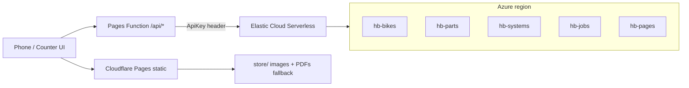

# Deploy — Elastic on Azure + Cloudflare Pages

Handy Book’s **Manuals store** and **Query layer** are both Elasticsearch
(Elastic Cloud Serverless in an **Azure** region). The static Counter app
(`counter/`) is hosted on **Cloudflare Pages**. A Pages Function at `/api/*`
holds the Elasticsearch API key so it never ships to the browser. Local
`store/` files remain the offline fallback.

Interpretation of “host the backend on Azure; MongoDB: https://www.elastic.co/”:
MongoDB in the architecture diagram is replaced by Elastic Cloud; Azure is the
cloud region, not a separate Mongo host.



| Component | Service | Region / placement |
|---|---|---|
| Manuals store + Query layer | Elastic Cloud Serverless (Elasticsearch) | Azure, nearest to operator (e.g. `azure-eastus`) |
| Indexes `hb-bikes`, `hb-parts`, `hb-systems`, `hb-jobs`, `hb-pages` | same project | same |
| Counter UI + `store/` static assets | Cloudflare Pages project `handy-book` | Cloudflare edge |
| `/api/*` proxy | Cloudflare Pages Function `functions/api/[[route]].js` | Cloudflare edge |
| Elasticsearch API key | Pages secret `ELASTIC_API_KEY`; local `.dev.vars` | never in git, never in the browser |
| Elasticsearch URL | Wrangler `[vars].ELASTIC_URL` (not a secret) | committed once known |

## Credentials (where they live)

| Secret / value | Where | How to set |
|---|---|---|
| Elastic Cloud **organization** API key | `elastic` CLI Cloud context (OS keychain) | Generate at [cloud.elastic.co/account/keys](https://cloud.elastic.co/account/keys) (Project Admin+). Register **without pasting into chat**: `elastic config context add cloud --cloud-url https://api.elastic-cloud.com --cloud-api-key <KEY>` then `elastic config current-context set cloud` |
| Elasticsearch **data-plane** API key | `.dev.vars` locally; Cloudflare secret in production | Created after the project exists (`POST /_security/api_key`). Local file is gitignored. Production: `npx wrangler pages secret put ELASTIC_API_KEY --project-name handy-book` (reads stdin; do not echo) |
| `ELASTIC_URL` | `wrangler.toml` `[vars]`; also `.dev.vars` | Public endpoint from the Serverless project. Safe to commit. |
| Cloudflare account | Wrangler OAuth | `npx wrangler login` |

Copy `.dev.vars.example` → `.dev.vars` and fill URL + key. Never commit `.dev.vars`.

## Provision Elastic (Azure)

Needs a working Cloud context (`elastic cloud orgs list-organizations` succeeds).

```powershell
elastic cloud serverless regions list-regions
# Pick an Azure region with project_creation_enabled, e.g. azure-eastus

# input.json — name + region_id only; no secrets
# { "name": "handy-book", "region_id": "azure-eastus", "optimized_for": "general_purpose" }
elastic cloud serverless projects search create --input-file input.json --wait --save-as handy-book
elastic cloud serverless projects search list
```

Wait until phase is `initialized`. Endpoints are safe to share; bootstrap
password is not — mint a scoped Elasticsearch API key and put that in
`.dev.vars` as `ELASTIC_API_KEY`. Set `ELASTIC_URL` to the Elasticsearch
endpoint (no trailing path).

If the CLI has no Cloud context, stop and run:

```powershell
elastic config context add cloud --cloud-url https://api.elastic-cloud.com --cloud-api-key <KEY>
elastic config current-context set cloud
```

(`<KEY>` is entered locally, not in chat.)

## Index the catalog

```powershell
$env:ELASTIC_URL = "https://YOUR-PROJECT.es.REGION.azure.elastic.cloud"
# set ELASTIC_API_KEY in this shell from .dev.vars — do not print it
python tools/index-elastic.py
```

Idempotent. `--reset` deletes and recreates the five indexes. Image-only PDF
pages are stored with empty `text` and `ocr: false` (no OCR in this indexer).
If a PDF is not on disk yet, empty page docs are still created from
`catalog.json` `manuals[].pages`.

Verify: `GET /api/bikes?q=cb` (after the Function is running) returns Honda.

## Deploy Cloudflare Pages

Needs `npx wrangler whoami` to show a logged-in account. If not:

```powershell
npx wrangler login
```

Then:

```powershell
npx wrangler pages project create handy-book
npx wrangler pages deploy . --project-name handy-book
npx wrangler pages secret put ELASTIC_API_KEY --project-name handy-book
```

Repo root is the Pages output dir (`pages_build_output_dir = "."`).
`_headers` and `_redirects` live at the repo root (Pages reads them from the
output directory). Copies under `deploy/` are the same rules for reference.
Pages allows one `*` per header rule; manuals use `/store/manuals/:manual/pages/*`.

Limits: 25 MiB per file, 20k files. Manual PDFs must stay under 25 MiB.
Wrangler skips `.git` / `node_modules`; `tools/` and other prototypes are
small enough to upload for the prototype.

After first deploy, put the real `ELASTIC_URL` in `wrangler.toml` `[vars]` and
redeploy (URL is not a secret). The API key stays a Pages secret.

## Local verify

```powershell
npx wrangler pages dev .
```

- `/` redirects to `/counter/`
- `/counter/` loads the app
- `/api/bikes?q=cb` returns Honda when Elastic is configured
- Without `.dev.vars` (or missing key), `/api/*` returns **503** JSON
  `{ "remote": false }` and the UI keeps using local `store/`

## Query-layer switch (later integration — not applied here)

`counter/js/query.js` stays the local catalog. `counter/js/store-remote.js`
exposes the same names (`findBikes`, `bike`, `manual`, `systems`, `partsFor`,
`part`, `job`, `jobById`) as **async** functions plus `isRemoteAvailable()`.

One-line switch for a later task in `counter/js/app.js`:

```js
const query = (await import("./store-remote.js").then((m) => m.isRemoteAvailable()).then((ok) => ok ? import("./store-remote.js") : import("./query.js")));
```

Do not edit `query.js` in this deploy task.
