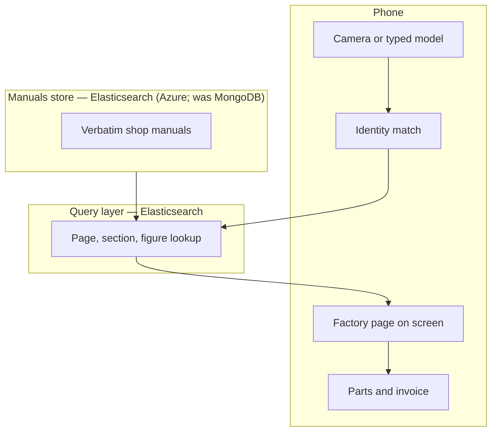

# Deploy — Elastic on Azure + Cloudflare Pages

Handy Book’s **Manuals store** and **Query layer** are both Elasticsearch
(Elastic Cloud Serverless in an **Azure** region). The static Counter app
(`counter/`) is hosted on **Cloudflare Pages**. A Pages Function at `/api/*`
holds the Elasticsearch API key so it never ships to the browser. Local
`store/` files remain the offline fallback.

Interpretation of “host the backend on Azure; MongoDB: https://www.elastic.co/”:
MongoDB in `architecture.html` is **replaced by Elastic Cloud**; Identity match
and Invoice stay. Azure is the Elastic Cloud region, not a separate Mongo host.



| Component | Service | Region / placement |
|---|---|---|
| Manuals store + Query layer | Elastic Cloud Serverless (Elasticsearch) | Azure, nearest to operator (e.g. `azure-eastus`) |
| Indexes `hb-bikes`, `hb-parts`, `hb-systems`, `hb-jobs`, `hb-pages` | same project | same |
| Counter UI + `store/` static assets | Cloudflare Pages project `handy-book` | Cloudflare edge |
| `/api/*` proxy | Cloudflare Pages Function `functions/api/[[route]].js` | Cloudflare edge |
| Elasticsearch API key | Pages secret `ELASTIC_API_KEY`; local `.dev.vars` | never in git, never in the browser |
| Elasticsearch URL | Wrangler `[vars].ELASTIC_URL` (not a secret) | committed once known |

## Credentials (where they live)

| Secret / value | Where | How to set |
|---|---|---|
| Elastic Cloud **organization** API key | `elastic` CLI Cloud context (OS keychain) | Generate at [cloud.elastic.co/account/keys](https://cloud.elastic.co/account/keys) (Project Admin+). Register **without pasting into chat**: `elastic config context add cloud --cloud-url https://api.elastic-cloud.com --cloud-api-key <KEY>` then `elastic config current-context set cloud` |
| Elasticsearch **data-plane** API key | `.dev.vars` locally; Cloudflare secret in production | Mint with `elastic es security create-api-key --input-file deploy/elastic/api-key.json` (skill Operations table). Local file is gitignored. Production: `npx wrangler pages secret put ELASTIC_API_KEY --project-name handy-book` (reads stdin; do not echo) |
| `ELASTIC_URL` | `wrangler.toml` `[vars]`; also `.dev.vars` | Public endpoint from the Serverless project. Safe to commit. |
| Cloudflare account | Wrangler OAuth | `npx wrangler login` |

Copy `.dev.vars.example` → `.dev.vars` and fill URL + key. Never commit `.dev.vars`.

## Provision Elastic (Azure)

Needs a working Cloud context (`elastic cloud orgs list-organizations` succeeds).
The JSON bodies live under `deploy/elastic/` — do not invent a loose `input.json`.

```powershell
elastic cloud serverless regions list-regions
# Pick an Azure region with project_creation_enabled. Default in
# deploy/elastic/project.json is azure-eastus — edit region_id if that region is closed.

elastic cloud serverless projects search create --input-file deploy/elastic/project.json --wait --save-as handy-book
elastic cloud serverless projects search list
elastic config current-context set handy-book
elastic es security create-api-key --input-file deploy/elastic/api-key.json
```

Wait until phase is `initialized` (`--wait` on create). Endpoints are safe to
share; the bootstrap admin password is not. The `create-api-key` command prints
an encoded data-plane key once — put that value in `.dev.vars` as
`ELASTIC_API_KEY` (do not paste it into chat). Set `ELASTIC_URL` to the
Elasticsearch endpoint (no trailing path).

If the CLI has no Cloud context, stop and run:

```powershell
elastic config context add cloud --cloud-url https://api.elastic-cloud.com --cloud-api-key <KEY>
elastic config current-context set cloud
```

(`<KEY>` is entered locally, not in chat.)

## Index the catalog

```powershell
$env:ELASTIC_URL = "https://YOUR-PROJECT.es.REGION.azure.elastic.cloud"
# set ELASTIC_API_KEY in this shell from .dev.vars — do not print it
python tools/index-elastic.py --dry-run
python tools/index-elastic.py
```

`--dry-run` builds every document from `store/catalog.json` with **no network
call** and prints per-index counts (no `ELASTIC_*` required).

Idempotent. `--reset` deletes and recreates the five indexes. Image-only PDF
pages are stored with empty `text` and `ocr: false` (no OCR in this indexer).
If a PDF is not on disk yet, empty page docs are still created from
`catalog.json` `manuals[].pages`.

Job Elasticsearch `_id`s use `bikeId__partId` (double underscore, never `/`).
`hb-pages.printedPage` is copied from job data (numeric stamps offset across
`job.pages`) or `null` — never the PDF index. Commerce provenance `new` /
`used` / `alts` is copied onto each job document.

Verify: `GET /api/bikes?q=cb` (after the Function is running) returns Honda.

## Deploy Cloudflare Pages

Needs `npx wrangler whoami` to show a logged-in account. If not:

```powershell
npx wrangler login
```

Then:

```powershell
npx wrangler pages project create handy-book
powershell -File deploy/assemble-publish.ps1
npx wrangler pages deploy .pages-publish --project-name handy-book
npx wrangler pages secret put ELASTIC_API_KEY --project-name handy-book
```

Do **not** `npx wrangler pages deploy .` — that would upload `tools/`, `deploy/`,
and the other prototype trees. Wrangler Pages does **not** honour `.wranglerignore`,
`.gitignore`, or `.assetsignore`. Upload exclusion is a hardcoded IGNORE_LIST
(`_worker.js`, `_redirects`, `_headers`, `_routes.json`, `functions`,
`**/.DS_Store`, `**/node_modules`, `**/.git`, `.wrangler`) in wrangler
`pages/validate.ts`. `_routes.json` only chooses Functions vs static routing; it
does not omit files from the upload. `.assetsignore` is Workers static assets,
not Pages. `.wranglerignore` at the repo root is the intended exclude list;
`deploy/assemble-publish.ps1` is the mechanism that actually keeps those trees
out of the published directory. Functions stay at repo root (`functions/`) —
Pages compiles them from cwd, not from the asset directory.

`wrangler.toml` `pages_build_output_dir = ".pages-publish"` (created by the
assemble script). That directory is gitignored (it copies `store/`, including
PDFs). `_headers` and `_redirects` are copied into that directory (Pages reads
them from the output dir). Copies under `deploy/` are the same rules for
reference. Pages allows one `*` per header rule; manuals use
`/store/manuals/:manual/pages/*`.

Limits: 25 MiB per file, 20k files. Manual PDFs must stay under 25 MiB.

After first deploy, put the real `ELASTIC_URL` in `wrangler.toml` `[vars]` and
redeploy (URL is not a secret). The API key stays a Pages secret.

## Local verify

On Windows, workerd needs an explicit bind address (spawn `EFTYPE` without `--ip`):

```powershell
npx wrangler pages dev . --ip 127.0.0.1 --port 8788
```

- `/` redirects to `/counter/`
- `/counter/` loads the app
- `/api/bikes?q=cb` returns Honda when Elastic is configured
- `/api/catalog` returns `{ bikes, systems, parts, manuals }` (no `jobs`) when
  Elastic is configured; Identify photo-ID uses `Q.catalog()?.bikes`
- Without `.dev.vars` (or missing key), **every** `/api/*` GET (including
  `/api/catalog`) returns **503** JSON `{ "remote": false }` and the UI keeps
  using local `store/`

The `.` directory argument serves the repo for local Functions + static assets.
It does not change the production assemble step.

## Query-layer switch (later integration — not applied here)

`counter/js/query.js` stays the local catalog. `counter/js/store-remote.js`
exports the same surface as `query.js`:

`loadCatalog`, `catalog`, `findBikes`, `bike`, `manual`, `systems`, `partsFor`,
`part`, `job`, `jobById`, `pageUrl`, `thumbUrl`, `asset`, plus `isRemoteAvailable()`.

`loadCatalog` fetches `GET /api/catalog` and resolves `true`. After it
resolves, `catalog()` returns `{ bikes, systems, parts, manuals }` (no `jobs`)
so `Q.catalog()?.bikes` works for Identify; on 503 or network failure that
object still has empty arrays. `pageUrl` / `thumbUrl` / `asset` are **sync**
and use the same path rules as `query.js`. Lookups that hit `/api/*` are
**async**. On 503 or network failure they return `[]` / `undefined` (or the
empty catalog shape) and do not throw.

One-line switch for a later task in `counter/js/app.js`:

```js
const query = (await import("./store-remote.js").then((m) => m.isRemoteAvailable()).then((ok) => ok ? import("./store-remote.js") : import("./query.js")));
```

Do not edit `query.js` in this deploy task.
